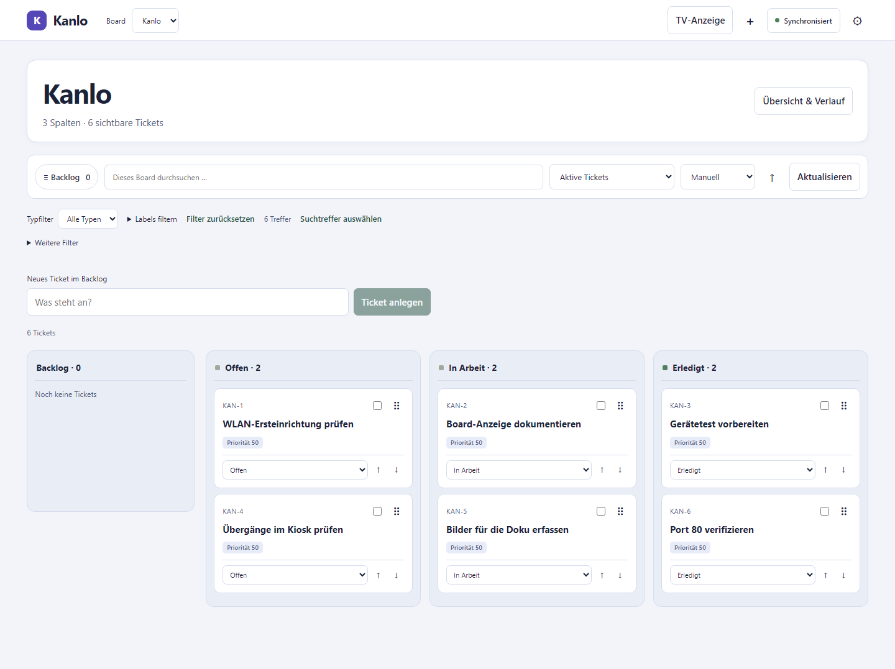

# Kanlo

Lokales Kanban für ein Debian-/Raspberry-Pi-Gerät mit einer Weboberfläche und
nativer Geräteanzeige. **Lokale Entwicklungsversion 0.2.0-dev.10.**

Die Originalanforderungen liegen unverändert unter `docs/baseline/`.
Gitea ist die Hauptquelle; GitHub spiegelt dieselben Commits. Der belegte
Aufgabenstand liegt bei **88,6 % (62 von 70 Originalaufgaben)**.
[Abnahme und Zählweise](docs/de/FORTSCHRITT.md)



Weitere Ansichten mit Beispieldaten findest du in der [Bildergalerie](docs/screenshots/README.md).

Die privaten Entwicklungspakete für Debian 13 enthalten den Server und die
Weboberfläche für AMD64, ARM64 und armhf. Installation:
[Deutsch](release/INSTALL-DE.md), [English](release/INSTALL-EN.md).
[Release-Ablauf](docs/de/RELEASES.md): Ein passender Versions-Tag startet alle
Prüfungen und erstellt danach automatisch einen Release mit Prüfsummen.

Dedizierte Geräte-Images für Raspberry Pi (ARM32/ARM64) und allgemeine UEFI-
Geräte (AMD64/ARM64): [Einrichtung und Hardwaregrenzen](release/IMAGES-DE.md),
[English](release/IMAGES-EN.md). Die Pipeline baut alle vier `.img.xz`-Varianten
mit Kanlo-Autostart, lokaler Einrichtung und erster nativer Boardanzeige.
Veröffentlichung verlangt zwei erfolgreiche Kernel-/systemd-Boots je Image.

## Starten

Voraussetzungen zum Bauen: Rust 1.99.1 und ein nativer C-Compiler für SQLite.
Die gebauten Webassets sind versioniert; Node wird zur Laufzeit nicht benötigt.

```sh
cargo run --locked -p kanlo-api --bin kanlo-server
```

`http://127.0.0.1:8080` öffnen. Das erste Board wird automatisch angelegt.
Der Server läuft ohne Bildschirm und ohne Internet. `KANLO_DATA_DIR` wählt die
private Datenablage. `KANLO_BIND` ist standardmäßig `127.0.0.1:8080`.
Eine LAN-Bindung braucht zusätzlich die exakten erlaubten Hostnamen/IP-Adressen
einschließlich Port in `KANLO_ALLOWED_HOSTS`. Details und der getrennte geschützte
HTTPS-Proxy-Zugang: [Betrieb](docs/de/BETRIEB.md).

## Umgesetzt

Die [Plugins für ChatGPT und Claude Code](plugins/kanlo/README.md) greifen über
MCP auf Kanlo-Boards, Spalten und Tickets zu. Schreibzugriff lässt sich pro
Verbindung freigeben.

Boards/Spalten, stabile Ticketkennungen, Typen, globale Labels, eigene Textfelder,
Untertickets, azyklische Abhängigkeiten, WIP-Limits, transaktionale Sammelaktionen,
Kommentare und sicheres Markdown, Archiv/Papierkorb, gruppiertes Undo,
Wiederholung, JSON/CSV-Import und Export, konsistente Datensicherungen und
vollständige/selektive Wiederherstellung. Alle Schreibwege benutzen dieselbe
Domainvalidierung.

Preact/TypeScript-Oberfläche für Telefon und PC, Deutsch/Englisch, Hell/Dunkel,
Suche/Filter/Sortierung und Tastatur-/Touchbedienung. Die PWA speichert besuchte
Boards und eine dauerhafte Offline-Warteschlange. Feldkonflikte und alte
Restore-Epochen brauchen eine ausdrückliche Entscheidung. Auf gewöhnlichem
LAN-HTTP bleibt die Website online nutzbar; Offline-PWA auf anderen Geräten
benötigt vertrauenswürdiges HTTPS.

Offen bleiben insbesondere vollständiges OpenAPI, die Abnahme der ChatGPT-
Einrichtung, der Updater, physische Geräteprüfungen und die öffentliche
Release-/Lizenzfreigabe.

## Prüfen und Webassets ändern

```sh
npm ci --prefix web
npm run build --prefix web
cargo fmt --all -- --check
cargo test --workspace --locked
cargo clippy --workspace --all-targets --locked -- -D warnings
npm ci --prefix tests/browser
npx --prefix tests/browser playwright install chromium --only-shell
npm test --prefix tests/browser
```

Der Webbuild schreibt nach `crates/kanlo-api/assets`. Diese Dateien zusammen mit
den Quellen committen. Die CI prüft, dass ein erneuter Build keine Abweichung
erzeugt. Die Browserprüfung startet getrennte lokale Testserver sowie einen
HTTPS-Testproxy mit einem ausschließlich im isolierten Testbrowser akzeptierten
Zertifikat. Es wird kein Zertifikat im Benutzer-/Systemspeicher installiert.

Debian-/Cross-/Headless-Abnahme: [Teststrategie](docs/de/TESTSTRATEGIE.md).
Windows ist eine Entwicklungsumgebung; ARM-Cross-Builds belegen keine
Laufzeit- oder Anzeigeleistung auf einem Raspberry Pi.

## Dokumentation und Rechte

- [Entwicklungsstand](docs/de/STATUS.md), [Roadmap](docs/de/ENTWICKLUNGSPLAN.md)
- [Anforderungsprüfung](docs/de/PRUEFUNG.md), [Architektur](docs/adr/0002-transactional-domain.md)
- [Repositories](docs/de/REPOSITORIES.md), [English guide](docs/en/README.md)
- [Drittanbieter-Inventar und Veröffentlichungsgates](docs/licenses/README.md)

Source-available ist das beabsichtigte Modell; der konkrete Lizenztext ist noch
nicht freigegeben. `LICENSE` erteilt keine öffentliche Nutzungslizenz. Die
Repositories bleiben privat. Keine OSI-Open-Source- oder Stable-Behauptung.
