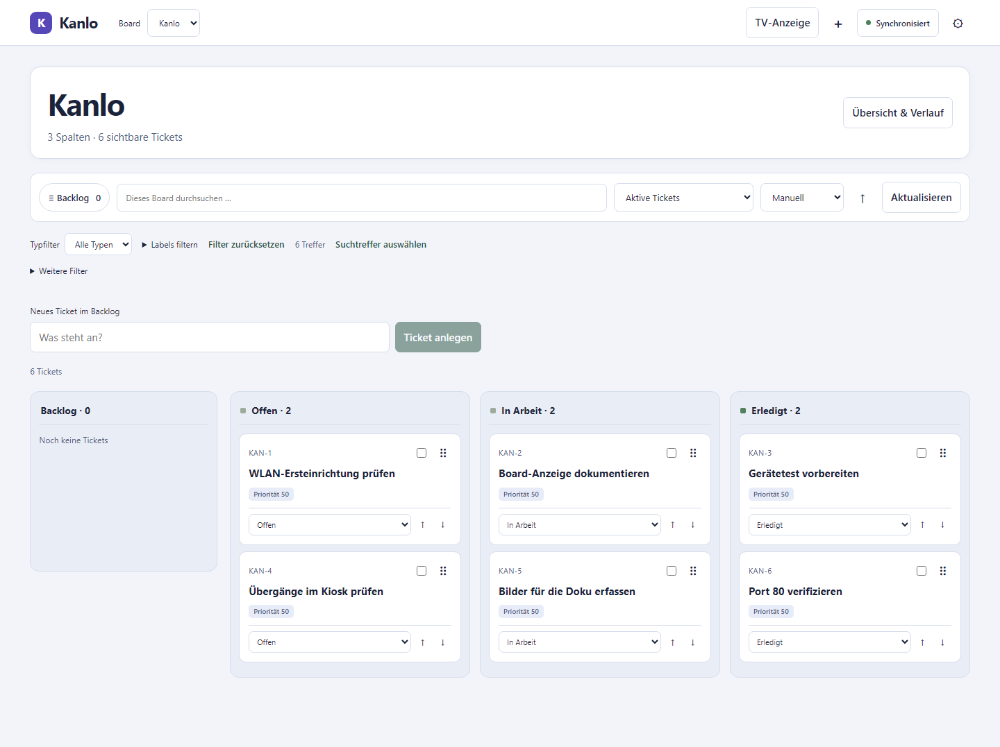
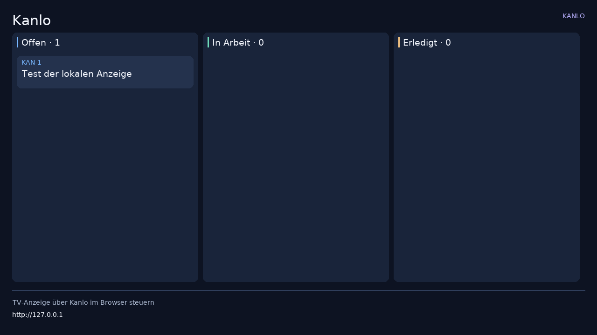
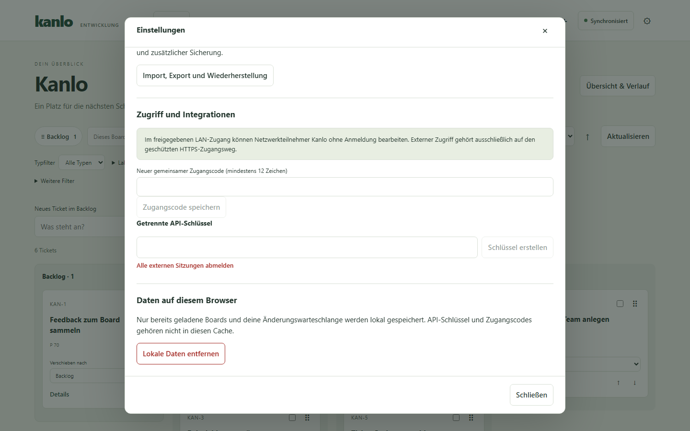

# Kanlo in Bildern

Die Aufnahmen zeigen das aktuelle Board-Design mit Beispieltickets.

## Board am Desktop

## Board auf dem Smartphone

## Ticket bearbeiten

## Lokale Anzeige

Für die lokale Anzeige dienten die [Android-TV-Layoutleitlinien](https://developer.android.com/training/tv/playback/compose/layouts)
als Referenz für aus der Entfernung lesbare Schrift. Das Web-Board orientiert
sich an der kompakten Navigation und Informationshierarchie in
[Linears UI-Redesign](https://linear.app/now/how-we-redesigned-the-linear-ui).

## API-Schlüssel für Integrationen

- [Zwei native Ticketfenster](tv-ticketpanels.png) mit Markdown-Tabelle und
  Checkliste in Weston bei 1280 × 720 Pixeln.
