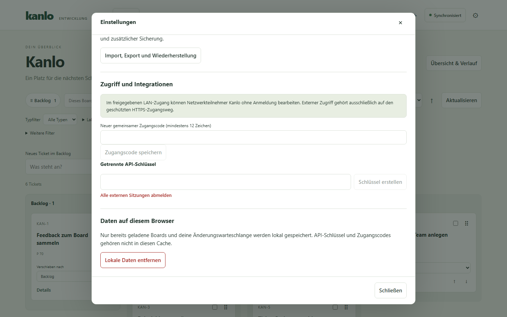

# Kanlo in ChatGPT einrichten

Du brauchst Kanlo ab 0.2.0-dev.3, Node.js ab Version 22 mit npm und
einen ChatGPT-Workspace, der eigene MCP-Server und private Tunnel zulässt.
Der Tunnel-Client läuft auf einem Rechner, der Kanlo erreichen kann.

1. Entpacke `kanlo-chatgpt-<Version>-source.zip` auf dem Rechner für den
   Tunnel-Client. Öffne ein Terminal im entpackten Ordner, prüfe
   `node --version` und führe `npm ci --omit=dev` aus.
2. Läuft Kanlo dort auf `http://127.0.0.1:8080`, greift die
   Standardeinstellung. Für eine entfernte Instanz setze `KANLO_URL`
   auf die geschützte HTTPS-Adresse ohne Pfad und `KANLO_API_KEY` auf
   einen widerrufbaren Kanlo-API-Schlüssel. Setze die Variablen in der
   Umgebung, aus der du den Tunnel-Client startest. Wenn du das Anlegen von
   Tickets sowie Bearbeitung, Kommentare und Verschieben freigeben willst, setze dort
   auch `KANLO_ENABLE_WRITES=1`.
   [Kanlo-Betriebsanleitung](https://git.tracht-digital.de/jtracht/Kanlo/src/branch/main/docs/de/BETRIEB.md)

   In Kanlo findest du das Formular unter **Einstellungen → Zugriff und Integrationen → Getrennte API-Schlüssel**.

   
3. Richte in OpenAI Platform einen privaten Secure MCP Tunnel für den
   Ziel-Workspace ein. Halte die Tunnel-ID bereit, installiere den offiziellen
   Tunnel-Client und hinterlege dessen Schlüssel als `CONTROL_PLANE_API_KEY`
   in seiner Prozessumgebung.
   [OpenAI-Anleitung für Secure MCP Tunnel](https://developers.openai.com/api/docs/guides/secure-mcp-tunnels)
4. Ersetze in den folgenden Befehlen `TUNNEL_ID` und den absoluten Pfad zu
   `server.mjs`. Das Beispiel verwendet einen Pfad ohne Leerzeichen. Führe
   die Befehle nacheinander im selben Terminal aus und lass den Client laufen.

   ```sh
   tunnel-client init --sample sample_mcp_stdio_local --profile kanlo --tunnel-id TUNNEL_ID --mcp-command "node /absoluter/pfad/server.mjs"
   tunnel-client doctor --profile kanlo --explain
   tunnel-client run --profile kanlo
   ```

5. Öffne [ChatGPT Plugins](https://chatgpt.com/plugins). Wähle **Add custom
   MCP server**, trage **Kanlo** als Namen ein und wähle unter **Connection**
   deinen privaten **Tunnel**. Wähle für diese Tunnel-Verbindung **No
   authentication**, prüfe die Hinweise und bestätige **Create as a plugin**.
   Der Kanlo-API-Schlüssel bleibt beim lokalen MCP-Prozess.
   [OpenAI-Anleitung zur Registrierung](https://developers.openai.com/api/docs/guides/custom-mcp-server)
6. Wähle Kanlo in einem neuen Chat und bitte ChatGPT: „Liste meine
   Kanlo-Boards auf.“ Falls der Tunnel in ChatGPT fehlt, prüfe seine Zuordnung
   zum Workspace und die Berechtigungen **Tunnels Read + Use**.
7. Gib das Plugin nur Personen frei, die auf die angebundene Kanlo-Instanz
   zugreifen dürfen. Die freigegebenen Personen nutzen dieselbe konfigurierte
   Verbindung.
