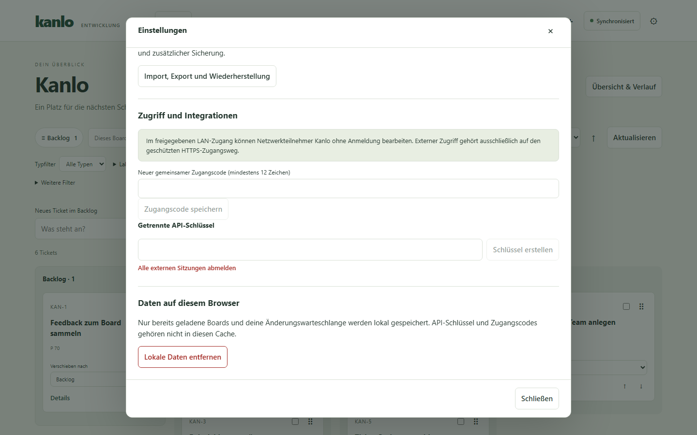

# Kanlo in Claude Code einrichten

Du brauchst Kanlo ab 0.2.0-dev.6, Claude Code und Node.js ab Version 22
mit npm. Das ZIP enthält den Plugin-Quellcode und die Abhängigkeitsliste.

1. Entpacke `kanlo-claude-code-<Version>-source.zip` und öffne ein Terminal im
   entpackten Ordner. Dort liegen `package.json` und `.mcp.json`.
2. Prüfe mit `node --version` die Node-Version und installiere die
   festgeschriebenen Abhängigkeiten mit `npm ci --omit=dev`.
3. Läuft Kanlo auf diesem Rechner am Standardport, ist die Adresse
   `http://127.0.0.1:8080` bereits voreingestellt. Für eine entfernte
   Instanz setze in demselben Terminal `KANLO_URL` auf die geschützte
   HTTPS-Adresse ohne Pfad und `KANLO_API_KEY` auf einen für das Plugin
   angelegten, widerrufbaren Kanlo-API-Schlüssel.

   Unter Linux und macOS kannst du die Adresse mit
   `export KANLO_URL=https://kanlo.example.org` setzen. In PowerShell
   lautet der Befehl `$env:KANLO_URL = 'https://kanlo.example.org'`.
   Hinterlege den Schlüssel nur in der Prozessumgebung.
   [Kanlo-Betriebsanleitung](https://git.tracht-digital.de/jtracht/Kanlo/src/branch/main/docs/de/BETRIEB.md)

   In Kanlo findest du das Formular unter **Einstellungen → Zugriff und Integrationen → Getrennte API-Schlüssel**.

   
4. Starte im entpackten Ordner `claude --plugin-dir .`. Um aus einem
   anderen Projektordner zu starten, gib den absoluten Pfad zum entpackten
   Plugin-Ordner an. [Claude Code Plugin-Referenz](https://code.claude.com/docs/en/plugins-reference)
5. Öffne `/mcp` in Claude Code und prüfe, ob **kanlo** verbunden ist.
   Bitte Claude anschließend: „Liste meine Kanlo-Boards auf.“
6. Wenn das Plugin Tickets anlegen, bearbeiten, kommentieren oder verschieben soll, setze `KANLO_ENABLE_WRITES` in
   derselben Umgebung auf `1` und starte Claude Code neu. Ohne diese
   Einstellung bietet das Plugin nur Lesezugriff an.

Der MCP-Adapter liest beim Start die verfügbaren Kanlo-Operationen aus
OpenAPI. Verwende einen laufenden Server ab `0.2.0-dev.6` mit
`/api/v1/openapi.json`. Bei gleichen Titeln liefert die Titelsuche die
passenden Kennungen für die Auswahl. Mit aktiviertem Schreibzugriff zeigt
`kanlo_preview_undo` die geplante Rückgängig-Aktion. Erst nach deiner
ausdrücklichen Bestätigung kann `kanlo_confirm_undo` sie ausführen.

Für Einstellungen zuerst „Welche Kanlo-Einstellungskategorien gibt es?“ fragen.
Nach Auswahl einer Kategorie zeigt das Plugin bis zu fünf Namen pro Seite.
Werte werden separat abgerufen. Für Board-Regeln mit Board-Auswahl
Kanlo 0.2.0-dev.10 verwenden.

Mit freigegebenem Schreibzugriff können globale Einstellungen und Board-Regeln
einzeln geändert werden. Dazu zuerst den aktuellen Wert lesen und die Änderung
ausdrücklich anfordern. Bei einem Konflikt den Wert erneut lesen und die
beabsichtigte Änderung bestätigen.
